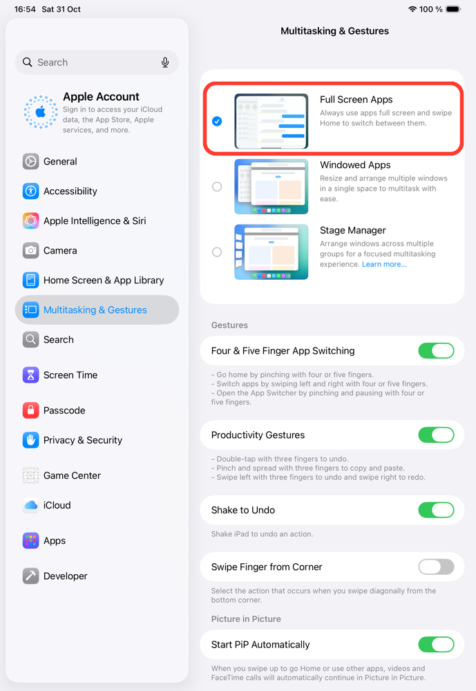

# Troubleshooting

## iPad: the agent stops responding, or taps and the UI dump stop working

On iPad, the agent needs apps to run full screen. With multitasking on (windowed
apps, Stage Manager, Split View or Slide Over), the agent doesn't get the
callbacks it relies on. It can stop responding after about 30 seconds, and taps,
UI dumps and screen streaming can fail.

Turn multitasking off before you automate an iPad, on real devices and simulators.

**iPadOS 26 and later:** Settings → Multitasking & Gestures → **Full Screen Apps**.

**iPadOS 17 and 18:** Settings → Multitasking & Gestures (on iPadOS 17: Home Screen
& Multitasking). Turn off **Stage Manager** and **Allow Multiple Apps**.

See [#428](https://github.com/mobile-next/mobilecli/issues/428).
